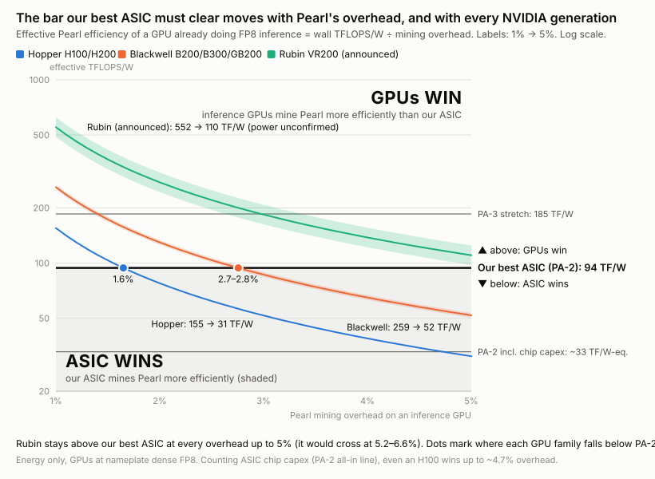
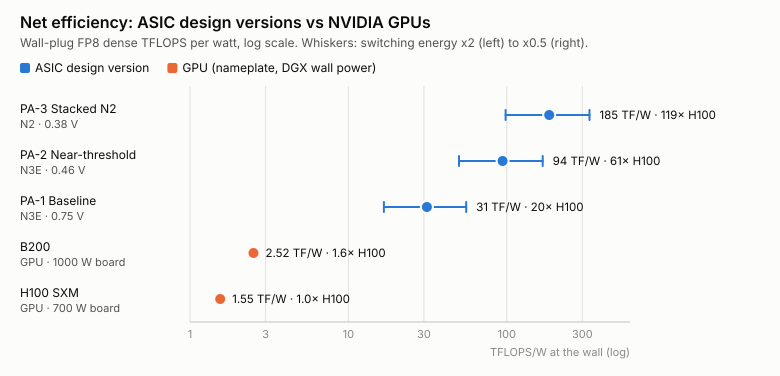
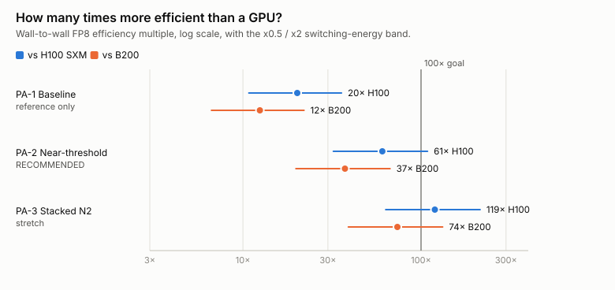
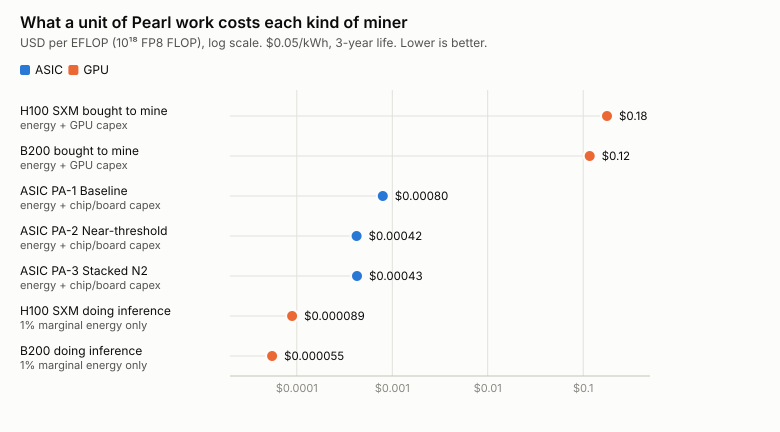
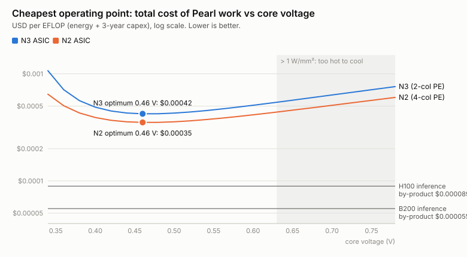
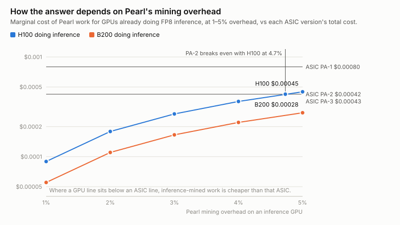

# pearl-asic-sim

**Could a custom chip mine Pearl's FP8 proof of useful work 100x more efficiently than an NVIDIA GPU?**

This project is a design study that answers that question. It contains:

- a **bit-exact hardware model** of a proposed mining ASIC's datapath, tested against Pearl's own verifier;
- a **first-principles energy, area and cost model** whose switching activity is measured from simulation;
- a **written report** with the design, the numbers, and the risks.

The full write-up is [docs/REPORT.md](docs/REPORT.md).

---

## Abstract

Pearl's upcoming FP8 proof of useful work (cert v4) asks miners to compute dense FP8 matrix products. The verifier replays each winning tile bit-exactly using the rounding of an NVIDIA H100 or B200 tensor core, and a "jackpot policy" rejects sparse or low-entropy inputs. We ask whether an ASIC could mine this 100x more efficiently than a GPU, and whether that would pay.

From the protocol source we find no algorithmic shortcut. Every ticket costs a genuine dense FP8 GEMM, so an ASIC's only lever is energy per multiply-accumulate. We built a bit-exact Rust model of a weight-stationary "DP32 atom" datapath that copies H100 rounding (30% cheaper than B200's for identical difficulty) and verified it bit-for-bit against Pearl's own verifier code. Around it we built a gate-level energy, area and cost model that uses switching activity measured in simulation.

Three versioned designs were evaluated:
- **PA-1**: N3 at nominal voltage. 20x an H100 at the wall, but too hot to cool.
- **PA-2** (recommended): N3 near threshold, 0.46 V. **~61x an H100 and ~37x a B200** in net wall-plug efficiency, with a ±2x model band of 32–109x.
- **PA-3**: N2 at 0.38 V with voltage-stacked boards. ~120x an H100, the only design to reach the 100x goal.

So 100x is physically reachable, but only at the aggressive edge.

Economically, the ASIC is 300–400x cheaper per unit of work than GPUs bought to mine. Whether it can compete with GPUs that mine as a by-product of paid inference depends on Pearl's mining overhead:
- At **1%** overhead, inference-mined work is 4.7x cheaper than PA-2 (H100) and 7.7x cheaper (B200).
- PA-2 breaks even with H100 inference-miners only at **~4.7%** overhead, and with B200s at **~7.7%**.

Silicon, not electricity, dominates ASIC cost. That is why the cost-optimal design sits at ~60–80x efficiency rather than the maximum.

Bottom line: our best practical Pearl ASIC is ~61x more energy-efficient than an H100. But a GPU mining as a 1% by-product of AI inference still produces Pearl work ~4.7x cheaper than that ASIC. The ASIC only breaks even if mining overhead reaches ~4.7%.



*How to read this chart:*
- A GPU already doing paid FP8 inference spends only the overhead share of its power on mining, so its effective Pearl efficiency is its wall TFLOPS/W ÷ overhead.
- At 1% overhead every NVIDIA generation beats our best ASIC (PA-2). Hopper drops below it at 1.6% and Blackwell at 2.7–2.8%.
- Rubin stays above it all the way to 5%. Each new GPU generation raises the bar.
- Counting the ASIC's own chip cost (the lower "all-in" line), even an H100 wins up to ~4.7%.
- The data is in [frontier-gpus-vs-asic.csv](docs/figures/frontier-gpus-vs-asic.csv).

---

## Key findings

### 1. The proof of work has no shortcut; only joules per FP8 MAC matter

Pearl's FP8 scheme (cert v4, `fp8-scheme@630b7316`) works like this:

- The verifier **recomputes the winning tile bit-exactly** using a named GPU's tensor-core rounding (H100 or B200).
- A jackpot policy rejects sparse, low-entropy or truncation-skippable data.
- Difficulty is `target · h · w · k`, i.e. normalised to multiply-accumulates.

So every ticket costs a genuine dense FP8 GEMM. Strassen, 2:4 sparsity, zero-skipping and reusing partial sums all fail either bit-exactness or the policy. The only lever an ASIC has is energy per FP8 MAC.

### 2. Copy H100 rounding, not B200's

Difficulty is the same for both device modes. But H100 accumulation keeps 13 fractional bits versus B200's 25. The hardware cost is **667 vs 958 gate-equivalents per MAC**, about 30% less silicon and energy for identical reward.

### 3. The chip needs no DRAM

The miner chooses its own matrices:
- **A** is generated on chip from a PRNG seed, twice: once to hash it into the commitment, then again to noise, quantise and multiply it.
- **B′** (the noised weights) depends only on an *ancestor* header, so it stays resident in clock-gated latches across many blocks.

There is no HBM, DDR or host bandwidth. Commitments, noise and tickets add **under 1%** to the cost of the GEMM.

### 4. The datapath is verified bit-exact

`cargo test --release` checks the model against Pearl's own `zk-pow` code: the H100 replay, the lane fold and the jackpot ticket hash. The tests cover Gaussian mining data, 3,000 adversarial random-code trials (subnormals, signed zeros, cancellation) and a full 16×16 tile through the core dataflow. **All are bit-identical.**

### 5. Three versioned designs; the recommended PA-2 is about 60x an H100 at the wall

| version | design | net TFLOPS/W (wall) | vs H100 | vs B200 | USD / EFLOP |
|---|---|---|---|---|---|
| PA-1 *Baseline* | N3, 0.75 V, 1-col PE (2.1 W/mm²; too hot to cool) | 31 | 20× | 12× | $0.00080 |
| **PA-2 *Near-threshold*** (recommended) | **N3, 0.46 V, 2-col PE** | **94** | **61×** (32–109×) | **37×** | **$0.00042** |
| PA-3 *Stacked N2* (stretch) | N2, 0.38 V, 4-col PE, voltage-stacked boards | 185 | 119× (63–215×) | 74× | $0.00043 |
| H100 SXM | GPU, nameplate, DGX wall power | 1.55 | 1× | 0.6× | $0.178 bought to mine |
| B200 | GPU, nameplate, DGX wall power | 2.52 | 1.6× | 1× | $0.117 bought to mine |

- Net efficiency is wall-plug: it includes power delivery and cooling. GPUs are at nameplate dense FP8, which flatters them.
- The ranges move the least-certain constant, switching energy per gate, by ×2 either way.
- A PA-2 die is about 130 mm² on N3, with 4.2M FP8 MACs per cycle, delivering about **3.9 PFLOPS at about 36 W**. One H100 does 1.98 PFLOPS at 700 W.
- **100x is reachable only with PA-3**, the most aggressive corner.
- Full spec sheets are in [docs/designs.md](docs/designs.md).





### 6. The economics decide it, not the physics



- **ASIC vs dedicated GPU miners:** the ASIC is about **300–400x cheaper** per unit of work. It would take the network.
- **ASIC vs GPUs mining as a 1% by-product of inference:** the ASIC is about **4.7x more expensive than H100s and 7.7x more than B200s**. Hashes that ride along on paid inference are nearly free.
- **Silicon dominates ASIC cost**, at about two-thirds. Lower voltage keeps buying efficiency, but below about 0.46 V the clock drops so far that capex per unit of work outgrows the energy saved. **PA-3 is twice as efficient as PA-2 but no cheaper per unit of work.**
- **ASICs stay profitable only while inference mining is small.** The inference fleet running the Pearl miner must stay below about **1.4M H100-equivalents** at full GEMM duty **per $100k/day of block rewards**.



### 7. The verdict is sensitive to Pearl's real mining overhead

The 1% overhead is a planning figure. Cost of the recommended PA-2 relative to the inference-GPU marginal cost:

| overhead | 1% | 2% | 3% | 4% | 5% | break-even |
|---|---|---|---|---|---|---|
| vs H100 doing inference | 4.73× | 2.37× | 1.58× | 1.18× | **0.95×** | **4.7%** |
| vs B200 doing inference | 7.67× | 3.84× | 2.56× | 1.92× | 1.53× | **7.7%** |

- Below 1.0, the ASIC is cheaper.
- Across the full 1–5% range, no design beats B200 inference-miners. Against H100s, parity arrives only near 5%.
- Tables for all versions are in [docs/designs.md](docs/designs.md#sensitivity-to-pearls-mining-overhead).



### 8. The biggest risk is the protocol, not the physics

- Pearl shipped four consensus forks in about three months: MoE, rank penalty, salted seed, FP8 v4.
- The device enum *fails closed on retired discriminants*. One fork can kill H100 mode, change the policy, or change tile/k bounds.
- An ASIC takes 12–18 months and tens of millions in up-front cost.
- The chip has no memory bandwidth, so it can't do useful inference if Pearl changes.

---

## Quick start

Requires Rust 1.85+ (edition 2024). The first test build fetches Pearl's `zk-pow` from GitHub as the oracle; it is pinned to commit `630b7316`.

```bash
cargo test --release            # model vs Pearl's verifier, bit-exact
cargo run --release             # full report tables: activity, gate inventory, corners, economics
cargo run --release -- sweep    # voltage sweep -> cost-optimal operating point
cargo run --release -- figures  # regenerate docs/figures/*.svg|csv and docs/designs.md
cargo run --release -- demo     # stream tiles through a core, hash tickets, count hits
cargo doc --open                # API docs for the model
```

## Repository layout

| path | contents |
|---|---|
| `src/fp8.rs` | OCP FP8 E4M3 encode/decode |
| `src/atom.rs` | **Golden reference**: bit-exact DP32 atom, window and promotion datapath (H100 semantics), written the way the RTL would be |
| `src/engine.rs` | Weight-stationary core, lottery fold, keyed-BLAKE3 ticket, operand generator, toggle-activity counters, timing |
| `src/energy.rs` | Gate inventory per atom, process-node and design-corner parameters, energy/area/frequency model, GPU baselines |
| `src/designs.rs` | **Versioned ASIC designs** (PA-1, PA-2, PA-3): parameters and change rationale |
| `src/figures.rs`, `src/plot.rs` | Dependency-free SVG figure and CSV table generator; also writes `docs/designs.md` |
| `src/econ.rs` | USD per EFLOP for ASIC, pure-GPU and inference-GPU miners |
| `src/main.rs` | CLI: `report`, `sweep`, `figures`, `demo` |
| `tests/oracle.rs` | Bit-exactness tests against `zk-pow` |
| `docs/REPORT.md` | **The full design report** |
| `docs/designs.md` | Generated spec sheet for each design version, compared with the GPUs |
| `docs/figures/` | Generated charts (SVG, light/dark aware) with CSV table views |
| `docs/protocol.md` | What Pearl's FP8 PoW computes, step by step, with source references |
| `docs/architecture.md` | Chip microarchitecture: dataflow, bit widths, timing, host integration |
| `docs/model.md` | Energy/economics model methodology, every assumption, and how to change them |

## Caveats

- These are model estimates, not silicon measurements. Nothing has been synthesised yet; see [docs/REPORT.md §9](docs/REPORT.md#9-next-steps-if-you-proceed) for the de-risking plan.
- GPU numbers are nameplate dense FP8, which flatters the GPU.
- The analysis tracks the unreleased `fp8-scheme` branch, which may still change before activation.

## License

[MIT](LICENSE) © 2026 Jeremiah Rogers
