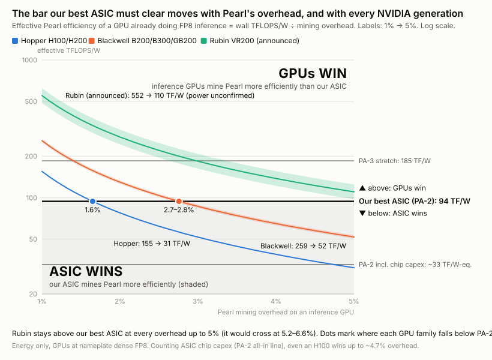
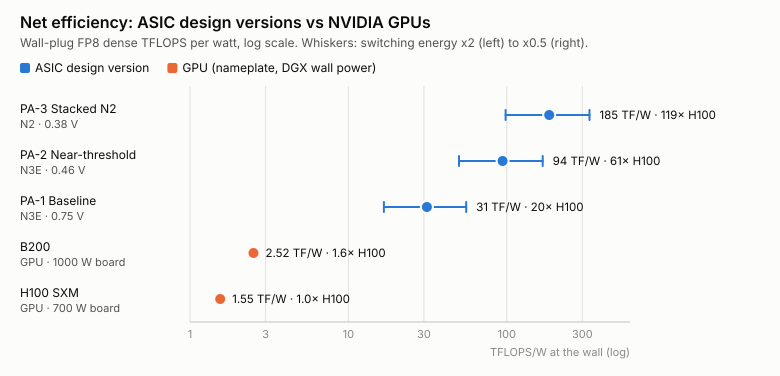
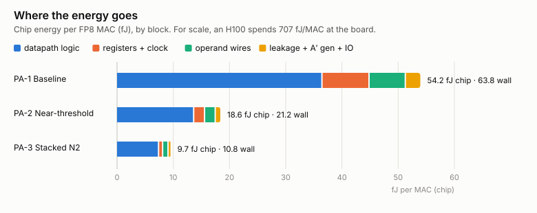
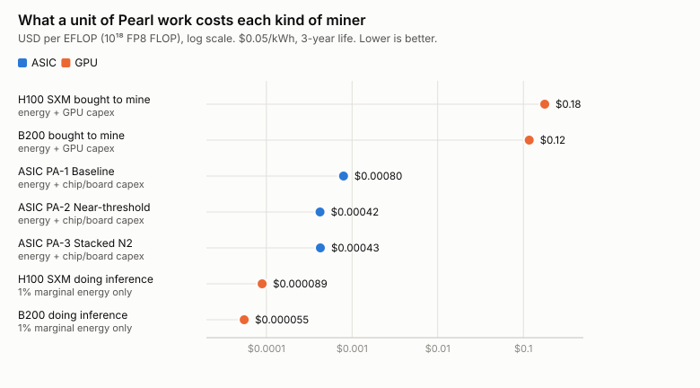
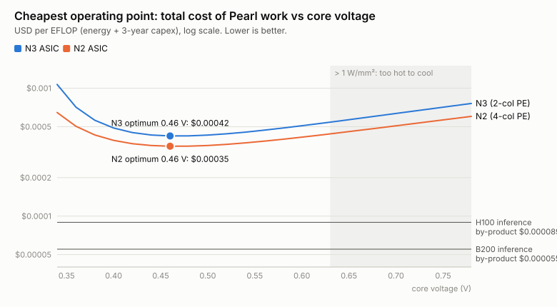
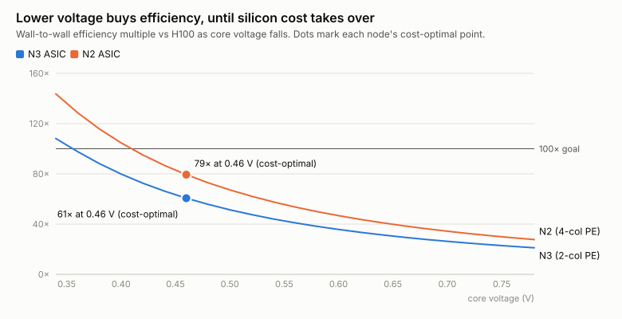
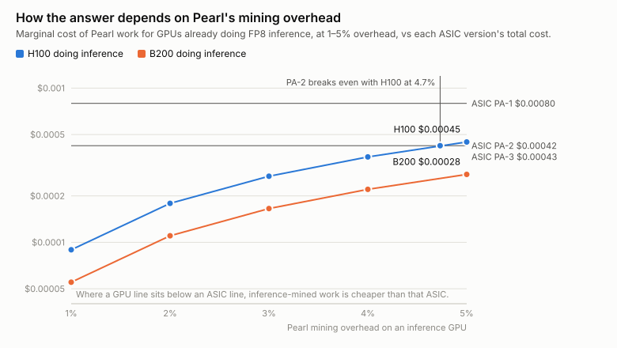

# A Pearl FP8 Mining ASIC — Design Report

*November 2026. Protocol analysed: `pearl-research-labs/pearl` branch `fp8-scheme` @ `630b7316` (cert v4).
Every number below can be reproduced with `cargo run --release`, `cargo run --release -- sweep` and `cargo run --release -- figures` in this crate.*

---

## Abstract

Pearl's upcoming FP8 proof of useful work (cert v4) asks miners to compute dense FP8 matrix products. The verifier replays each winning tile bit-exactly using the rounding of an NVIDIA H100 or B200 tensor core, and a "jackpot policy" rejects sparse or low-entropy inputs. We ask whether an ASIC could mine this 100x more efficiently than a GPU, and whether that would pay.

From the protocol source we find no algorithmic shortcut. Every ticket costs a genuine dense FP8 GEMM, so an ASIC's only lever is energy per multiply-accumulate. We built a bit-exact Rust model of a weight-stationary "DP32 atom" datapath that copies H100 rounding (30% cheaper than B200's for identical difficulty) and verified it bit-for-bit against Pearl's own verifier code. Around it we built a gate-level energy, area and cost model that uses switching activity measured in simulation.

Three versioned designs were evaluated:
- **PA-1**: N3 at nominal voltage. 20x an H100 at the wall, but too hot to cool.
- **PA-2** (recommended): N3 near threshold, 0.46 V. **~61x an H100 and ~37x a B200** in net wall-plug efficiency, with a ±2x model band of 32–109x.
- **PA-3**: N2 at 0.38 V with voltage-stacked boards. ~120x an H100, the only design to reach the 100x goal.

So 100x is physically reachable, but only at the aggressive edge.

Economically, the ASIC is 300–400x cheaper per unit of work than GPUs bought to mine. Whether it can compete with GPUs that mine as a by-product of paid inference depends on Pearl's mining overhead:
- At **1%** overhead, inference-mined work is 4.7x cheaper than PA-2 (H100) and 7.7x cheaper (B200).
- PA-2 breaks even with H100 inference-miners only at **~4.7%** overhead, and with B200s at **~7.7%**.

Silicon, not electricity, dominates ASIC cost. That is why the cost-optimal design sits at ~60–80x efficiency rather than the maximum.

Bottom line: our best practical Pearl ASIC is ~61x more energy-efficient than an H100. But a GPU mining as a 1% by-product of AI inference still produces Pearl work ~4.7x cheaper than that ASIC. The ASIC only breaks even if mining overhead reaches ~4.7%.

---

## 1. Answer first



*How to read this chart:*
- A GPU already doing paid FP8 inference spends only the overhead share of its power on mining, so its effective Pearl efficiency is its wall TFLOPS/W ÷ overhead.
- At 1% overhead every NVIDIA generation beats our best ASIC (PA-2). Hopper drops below it at 1.6% and Blackwell at 2.7–2.8%.
- Rubin stays above it all the way to 5%. Each new GPU generation raises the bar.
- Counting the ASIC's own chip cost (the lower "all-in" line), even an H100 wins up to ~4.7%.
- The data is in [frontier-gpus-vs-asic.csv](figures/frontier-gpus-vs-asic.csv).

**Is 100x the efficiency of an NVIDIA GPU possible?** On energy, it's barely possible, and only in the most aggressive corner.

| comparison (FP8 dense) | **PA-2** (recommended): N3, 0.46 V | **PA-3** (stretch): N2, 0.38 V, voltage-stacked |
|---|---|---|
| vs **H100**, wall-to-wall | **~61x** (band 32–109x) | **~120x** (band 63–215x) |
| vs **H100**, chip vs. board | ~38x | ~73x |
| vs **B200**, wall-to-wall | ~37x | ~74x |

The bands come from moving the model's least-certain constant (switching energy per gate) by 0.5x and 2x. The three design versions (PA-1 baseline, PA-2, PA-3) are specified in [designs.md](designs.md).



**Hitting 100x on energy still doesn't make the ASIC win against inference-mined hashes.** Suppose mining costs about 1% extra on a GPU that is already doing paid FP8 inference. Then the GPU's *marginal* cost of Pearl work is about 1% of its energy bill, and nothing for hardware. At ~100x efficiency the ASIC's electricity merely matches that floor. Its silicon, boards and PSUs cost another ~2–3x on top, so at the cost-optimal operating point the ASIC's total cost per unit of work is **~4.7x higher than an H100's inference marginal cost**, and ~7.7x higher than a B200's (§6).

That conclusion is sensitive to the overhead figure (§6.1). PA-2 breaks even with H100 inference-miners at ~4.7% overhead, and with B200s at ~7.7%.

So:

- **Against pure-mining GPUs, an ASIC wins overwhelmingly**: ~300–400x cheaper per unit of work, because a $30k H100 is mostly capex. If most of Pearl's hashrate comes from rented or dedicated GPUs, an ASIC takes the network.
- **Against inference GPUs, the ASIC loses at the margin.** It can't beat hashes that are almost free. ASICs only stay profitable while the inference fleet running the Pearl miner is small relative to the block reward. The threshold is ~1.4M H100-equivalents at full GEMM duty per $100k/day of block rewards (§6).

The physics allows it. The economics depend on how much of the world's inference runs the Pearl miner, and the protocol risk (§8) is severe.

---

## 2. What the FP8 proof of work actually demands

I read this from the source (`zk-pow/src/api/fp8/*`, `miner/pearl-gemm`), not from marketing.

1. **Commit.** BF16 operands are pre-quantised into int8 codes plus a BF16 scale per 8 codes (1.25 B/element), then committed with a keyed BLAKE3 Merkle tree. This gives `H_A` and `H_B`.
2. **Seeds.**
   - `seedB = H(H_B ‖ keyB(ancestor header) ‖ pB)`
   - `seedA = H(H_A ‖ seedB ‖ keyA(proposed header) ‖ pA)`

   Because `seedB` depends only on B and an *ancestor* header, **the noised weights B′ stay fixed across many blocks.** Only A′ must be regenerated per job.
3. **Noise and quantisation.** Rank-32 noise `E·F` is drawn from BLAKE3 lines and added, then the result is quantised to FP8 E4M3: `A′ = fp8(A/α + E_A·F_A)`.
4. **GEMM.** Compute `C = A′·B′ᵀ` *bit-exactly in a committed device's tensor-core semantics* (`Device::H100` or `Device::B200`).
   - H100: 32-product atoms aligned to the group's max exponent and truncated to **13 fractional bits**. Four atoms chain into a 128-product window that is promoted into FP32 with round-to-nearest-even.
   - B200: 25 fractional bits.
5. **Lottery.**
   - A tile is h×w cells, with `256 ≤ h·w ≤ 2048`, `h ≥ 4` and `w ≥ 16`.
   - Its FP32 cell bits are folded into 16 lanes with `lane = rotl(lane·0x9E3779B1 + bits, 13)`.
   - The 64-byte fold is hashed with BLAKE3 keyed by `seedA`.
   - The tile wins if **`hash ≤ target · h · w · k`**. Difficulty is normalised to MACs and is **the same for both devices**.
6. **Jackpot policy.** The verifier rejects tiles whose data is cheap to compute:
   - **Liveness**: at most 1/64 of entries may be outliers.
   - **Noise floor**: every row's noise σ must be at least 1.
   - **Unpredictability**: at most 5% of products may be skippable under truncation.

What this means for an ASIC:

- **No algorithmic shortcut.** Strassen-style algorithms, sparsity (2:4 is rejected by the liveness rule), zero-skipping and reusing partial sums all break either bit-exactness or the policy. Each ticket really costs h·w·k dense FP8 MACs. The only lever is **joules per FP8 MAC**.
- **Pick H100 semantics.** Its window is half as wide, so the atom needs **667 GE per MAC versus 958 for B200**, which is 30% less silicon and energy. Difficulty is the same either way.
- **No DRAM.** The miner chooses A and B, so the chip can generate them from a PRNG seed. A is generated twice: once to hash it (for `H_A`), and again to noise, quantise and multiply it. B′ stays resident. No HBM, no DDR, no PCIe bandwidth.
- **Overhead is negligible.** BLAKE3 commitments, noise and tickets amortise to well under 1% of the GEMM (§5).

---

## 3. Architecture

```
 BOARD  (voltage-stacked string of N chips, 1 controller, Ethernet → host/pool)
   └─ CHIP  (~130 mm² N3 / ~110 mm² N2, no DRAM)
        ├─ A′ GENERATOR (one per chip, amortised over 2048 columns)
        │    PRNG(seed) → BF16 A → prequant (int8 + bf16/8) ─┬─► BLAKE3 Merkle (pass 1 → H_A)
        │                                                    └─► pass 2: E_A lines (BLAKE3 XOF)
        │                                                        · E_A@F_A on DP32 atoms (F_A: 64 KB SRAM)
        │                                                        · noisy-quant → FP8 A′ row
        ├─ SYSTOLIC ARRAY: 128 cores × 16 columns = 2048 output columns, k = 2048
        │    A′ row (2 KB) snakes column→column, 1 row / cycle
        │    CORE = 16 cols × 64 atom slots; atom PE(j,c) holds B′[j, 32c..32c+32]
        │      in clock-gated latches (weight-stationary, zero dynamic energy)
        │    · 4 atoms chain one window (carry passed down)
        │    · windows run in parallel; an FP32 promotion chain per column
        │    · 2- or 4-column PEs share one A′ operand register
        ├─ EPILOGUE per core: 16-row tile buffer → 16-lane fold → BLAKE3 → compare(target·h·w·k)
        └─ CONTROLLER: job/seed registers, hit FIFO (tile base, row/col ids), JTAG, telemetry
 HOST: rebuilds the winning A/B rows + Merkle openings from seeds; pool/gateway does the plonky2 ZK proof
```

**Throughput.** 131,072 atoms × 32 = **4.2M FP8 MACs per cycle per chip**.
- PA-2 runs at 0.46 V and ~0.46 GHz: 3.9 PFLOPS per chip at ~36 W, or 0.27 W/mm². That power density is similar to a Bitcoin ASIC and air-coolable. For scale, one H100 is 1.98 PFLOPS at 700 W.
- A 16×16 tile completes every 16 cycles per core, so the 128 cores emit about 3.7 billion tickets per second. Each ticket is 256 × 2048 MACs.

**Bit widths.** These were proven sufficient by the bit-exact model in `src/atom.rs`:

| block | width |
|---|---|
| product | 4b×4b significand → 8b, 5b exponent, sign |
| anchor | 8-bit max over 33 live terms (32 products + carry) |
| align | 15-bit right shift, saturating at 15 (4 control bits) |
| adder | 33-input CSA, 16-bit terms → 22-bit carry-propagate adder |
| normalise | leading-zero count, truncate to 14 bits, subnormal clamp, repack to FP32 bits |
| promote | one FP32 RNE adder per 4 atoms |

---

## 4. Verification of the datapath (done)

`cargo test --release` runs the Rust model against **Pearl's own verifier code** (`zk_pow::api::fp8::utils::H100::matmul_fp8_policy_replay`, `xor_fold_extract`, `transcript::compute_jackpot_ticket`), pinned to `630b7316`:

| test | coverage | result |
|---|---|---|
| Gaussian mining data | k = 32 … 4096, including k not divisible by 128 | bit-exact |
| Adversarial uniform codes | 3,000 trials; all non-NaN E4M3 codes, subnormals, signed zeros, huge dynamic range | bit-exact |
| Tiny / cancelling values | exact cancellation across windows, subnormal-only data | bit-exact |
| Full core dataflow + fold + ticket | 16×16 tile, k = 1024, real `lane_assignment` | bit-exact, same ticket hash |

So the architecture's order of operations (parallel windows, chained atoms, ascending promotion) reproduces what the verifier computes. A hit found by this datapath is a valid Pearl proof.

---

## 5. Energy model

**Method.** Gate-equivalents per atom are counted from the widths above. Switching activity is *measured* by the simulator on noisy-quant-like operands:
- A′ bus toggle rate: α = 0.44
- adder-tree inputs: α = 0.41
- products truncated away: 0.25% (well under the policy's 5% limit)

Calibration: Horowitz 45 nm data (an 8-bit add is 0.03 pJ), scaled to N3. That gives 0.12 fJ per gate toggle at 0.75 V, with voltage scaling as V². Leakage uses DIBL scaling, and frequency follows the alpha-power law.

| fJ per MAC | PA-1: N3 0.75 V | PA-2: N3 0.46 V | PA-3: N2 0.38 V |
|---|---|---|---|
| datapath logic | 36.6 | 13.8 | 7.5 |
| registers + clock | 8.4 | 1.9 | 0.7 |
| operand wires | 6.5 | 1.9 | 1.0 |
| leakage | 0.3 | 0.2 | 0.1 |
| A′ generation, hashing, noise, epilogue, misc | 2.5 | 0.9 | 0.5 |
| **chip** | **54** | **18.6** | **9.8** |
| **wall** (power delivery, cooling) | 64 | 21.3 | 10.8 |
| chip efficiency (TFLOPS/W) | 37 | 107 | 205 |
| clock / power density | 1.2 GHz / **2.1 W/mm² (too hot)** | 0.46 GHz / 0.27 W/mm² | 0.32 GHz / 0.12 W/mm² |



**GPU baselines** (dense FP8 at nameplate, which flatters the GPU because sustained GEMMs throttle; 2:4 sparse peaks are unusable):

| GPU | board | wall |
|---|---|---|
| H100 SXM | 1,979 TF / 700 W = **707 fJ/MAC** | 1,289 fJ/MAC (DGX H100 10.2 kW / 8) |
| B200 | 4,500 TF / 1,000 W = **444 fJ/MAC** | 794 fJ/MAC (DGX B200 14.3 kW / 8) |

**Why the gap is so large.** In a GPU the FP8 math itself is a small slice of the power. Most goes to register files, shared memory, L2, HBM, instruction issue and clocking a general-purpose machine. The ASIC deletes all of that. What's left is roughly 670 GE per MAC of arithmetic, with operands that move one PE pitch per use.

**Sanity check.** 3 nm SRAM digital compute-in-memory macros report 125 TOPS/W for INT8, which is about 16 fJ/MAC at macro level. PA-2's 18.6 fJ/MAC for the *whole chip*, doing FP8 with H100-exact alignment, is in the same range. So the model is not fantasy, but PA-3 requires everything to go right.

---

## 6. Economics — the decisive section

Assumptions: $0.05/kWh, 3-year life, 95% uptime, $10 package per die, $0.80/W for boards, PSUs and cooling, 80% yield. Wafers cost $20k (N3) or $28k (N2). Costs are in USD per EFLOP (10¹⁸ FLOP) of Pearl work.

| miner | energy | capex | **total** |
|---|---|---|---|
| H100 pure mining | 0.0089 | 0.1685 | **0.178** |
| B200 pure mining | 0.0055 | 0.1112 | **0.117** |
| H100 doing inference (1% marginal) | 0.00009 | 0 | **0.00009** |
| B200 doing inference (1% marginal) | 0.00006 | 0 | **0.00006** |
| ASIC PA-1 (N3, 0.75 V) | 0.00044 | 0.00035 | **0.00080** |
| **ASIC PA-2 (N3, 0.46 V, cost-optimal)** | 0.00015 | 0.00028 | **0.00042** |
| ASIC PA-3 (N2, 0.38 V) | 0.00008 | 0.00035 | **0.00043** |
| *(N2 at its 0.46 V cost optimum)* | 0.00011 | 0.00024 | *0.00035* |







Findings:

1. **Capex now dominates the ASIC's cost**, at about two-thirds. That's why the cost-optimal voltage (~0.46 V) is *above* the most energy-efficient one. Running at 0.34 V gives 108–143x H100 efficiency, but the silicon then sits mostly idle and total cost goes *up*. Chasing "100x efficiency" is therefore the wrong objective. The right one is minimum $/EFLOP, which lands at about **60–80x H100 wall efficiency**.
2. **Against pure GPU miners: ASIC ≈ 300–400x cheaper.** Not close.
3. **Against GPUs mining as a by-product of inference: ASIC ≈ 4–5x *more* expensive** than H100s, and 7–8x more than B200s. No plausible ASIC closes this. Even zero-cost silicon at 205 TFLOPS/W only reaches parity with H100 inference-miners on energy.
4. **When ASICs remain viable.** Difficulty is set by total work. ASICs stay profitable while the inference fleet running the Pearl miner (at 100% FP8 GEMM duty) is below about **1.4–1.7M H100-equivalents (0.6–0.7M B200s) per $100k/day of block rewards**. Real inference runs at well under 100% GEMM duty, which raises those thresholds. If Pearl stays a niche miner on rented GPUs, an ASIC dominates. If a large share of global inference turns the Pearl plugin on, the ASIC gets priced out.

---

### 6.1 Sensitivity to Pearl's mining overhead

The 1% overhead is a planning figure, not a measurement. The real overhead covers pre-quantisation, Merkle hashing, noise generation, noisy quantisation, the GEMM epilogue, and any loss of inference throughput. Because the inference-miner's marginal cost scales linearly with that overhead, the ASIC's competitiveness does too.

Ratio of ASIC total cost to inference-GPU marginal cost (below 1.0, the ASIC is cheaper):

| version | vs | 1% | 2% | 3% | 4% | 5% | break-even |
|---|---|---|---|---|---|---|---|
| PA-1 | H100 inference | 8.90× | 4.45× | 2.97× | 2.23× | 1.78× | 8.9% |
| PA-1 | B200 inference | 14.44× | 7.22× | 4.81× | 3.61× | 2.89× | 14.4% |
| **PA-2** | **H100 inference** | 4.73× | 2.37× | 1.58× | 1.18× | **0.95×** | **4.7%** |
| **PA-2** | **B200 inference** | 7.67× | 3.84× | 2.56× | 1.92× | 1.53× | **7.7%** |
| PA-3 | H100 inference | 4.78× | 2.39× | 1.59× | 1.19× | 0.96× | 4.8% |
| PA-3 | B200 inference | 7.75× | 3.87× | 2.58× | 1.94× | 1.55× | 7.7% |



Honest reading:
- Across the whole 1–5% range, **no design beats B200 inference-miners**.
- Against H100 inference-miners, PA-2 and PA-3 reach parity only near 5%.
- The ASIC case therefore improves materially if real-world overhead lands at the high end, or if electricity is cheaper for the ASIC operator than for inference datacentres. It doesn't flip at the 1% planning figure.

The table is regenerated by `cargo run --release -- figures` (`docs/designs.md`, `docs/figures/overhead-sensitivity.csv`).

## 7. Recommended design point: PA-2 "Near-threshold"

- **Process / voltage**: TSMC N3E, ~0.46 V core, near-threshold-capable standard-cell library (HVT/SVT mix). Boards voltage-stack about 25 chips per string, Bitcoin-miner style, to keep power-delivery losses near 7%.
- **Die**: ~130 mm², 2048 columns × k = 2048, 4.2M FP8 MAC/cycle, ~0.46 GHz → ~3.9 PFLOPS at ~36 W.
- **PEs**: 2-column PEs (4 on N2) with B′ in clock-gated latches. A′ flows through a systolic snake. Commit to H100 semantics.
- **Protocol parameters**: k = 2048, 16×16 tiles, m ≈ 2²⁰ rows per commitment, total n ≈ 16k columns per board-level B commitment.
- **Expected**: ~95 TFLOPS/W at the wall, which is **~60x an H100 and ~37x a B200**. That is roughly $0.0004 per EFLOP, or about 400x cheaper than pure-GPU mining.
- **N2 follow-on**: at its own 0.46 V cost optimum, about 80x H100 and ~17% cheaper per EFLOP. PA-3's 0.38 V gives ~120x but no cost advantage over PA-2. Only worth it if the protocol is stable.

---

## 8. Risks (read before spending money)

1. **Protocol agility is the biggest risk.** In about three months the chain shipped the MoE hard fork, the rank-penalty soft fork (which patched a work-accounting shortcut), the salted-seed hard fork and now the FP8 v4 scheme. `Device::try_from` explicitly "fails closed on an unrecognized (or retired) discriminant". The developers can retire H100 semantics, tighten the jackpot policy, or change k/tile bounds with one fork. An ASIC takes 12–18 months and tens of millions in N3 NRE (masks alone are eight figures). Expect the developers to treat a no-inference ASIC as an attack on the proof-of-useful-work premise.
2. **This ASIC is useless for real work.** It has no memory bandwidth, so it can't serve models. It has no fallback value if Pearl changes.
3. **Model uncertainty is ±2x** on switching energy, and nothing has been synthesised. Treat the multiples as ranges: 32–109x (PA-2) and 63–215x (PA-3) versus H100.
4. **Policy compliance.** The synthetic data passes the truncation budget easily (0.25% dropped versus 5% allowed). A full end-to-end check against `verify_plain_proof` (liveness and noise-floor checks with real prequant scales) is the next validation step.
5. **The GPU baseline keeps moving.** Rubin-class parts will narrow the gap by another ~1.5–2x per generation, while a mining ASIC's advantage is fixed at tape-out.

---

## 9. Next steps if you proceed

1. Write SystemVerilog RTL for the DP32 atom and core. Use this Rust model as the golden reference (Verilator + cocotb, millions of random vectors).
2. Synthesise at a real N3/N5 PDK, or a public 7 nm-class PDK, to replace the `e_ge` assumption with real power numbers. This is the single biggest de-risking step.
3. Run an end-to-end proof: generate A and B, commit, find a hit with the model, build a `PlainProof`, and check it with `verify_plain_proof_for_cert_version(4, …)`.
4. Build an FPGA prototype of one core to validate dataflow, the ticket path and host integration with `pearl-gateway`.
5. Before any tape-out: get confidence on protocol stability, and estimate the inference fleet's share of hashrate (the §6.4 threshold).

---

## Sources

- Pearl source: `zk-pow/src/api/fp8/{utils,jackpot_policy,public_params,transcript,noise}.rs`, `zk-pow/src/api/{layout,proof_utils}.rs`, `miner/pearl-gemm/README.md` (branch `fp8-scheme` @ `630b7316`); fork history in `docs/*-upgrade-guide.md` and commits `51a6e11b`, `fc5ca65a`.
- Pearl PoUW paper: <https://arxiv.org/abs/2504.09971>
- H100 specs (1,979 TF dense FP8, 700 W): <https://microway.com/wp-content/uploads/2024/04/NVIDIA-H100-Datasheet-Microway.pdf>, <https://www.thundercompute.com/blog/nvidia-h100-specs-full-guide>; GEMM throttling: <https://forums.developer.nvidia.com/t/h100-pcie-hgemm-cannot-reach-peak-performance/291780>
- 3 nm digital CIM (125 TOPS/W INT8, 29 TFLOPS/W FP16) and the 3 nm INT12 DCIM ISSCC 2024 paper: <https://sscs.ieee.org/tag/digital-computing-in-memory-dcim/>, <https://dblp.uni-trier.de/rec/conf/isscc/FujiwaraMZKLPJCHHNTLLLCAAWCCLC24.html>; FP8 CIM at 28 nm: <https://arxiv.org/html/2602.05743v1>
- Near-threshold, voltage-stacked mining ASICs: Intel BonanzaMine, ISSCC 2022 (355 mV/stage) <https://ieeexplore.ieee.org/document/9731547>, <https://fuse.wikichip.org/?p=6603>; 3 nm sub-10 J/TH claims <https://d-central.tech/how-advancements-in-lithography-have-improved-bitcoin-mining-efficiency/>
- Frontier GPU specs (dense FP8, i.e. half the sparse headline): HGX/DGX B300 <https://www.nvidia.com/en-us/data-center/hgx/>, <https://flopper.io/system/nvidia-hgx-b300-8-gpu/spec-sheet>, <https://flopper.io/system/nvidia-dgx-b300/spec-sheet.pdf>; GB200 NVL72 (5 PF/GPU, 1.2 kW TDP, ~1.87 kW all-in) <https://inferencex.semianalysis.com/chips/gb200-nvl72>, <https://www.nvidia.com/en-gb/data-center/gb200-nvl2/>; Rubin VR200 (17.5 PF dense FP8; power reported 1.8–2.3 kW, unconfirmed) <https://glennklockwood.com/garden/processors/R200>, <https://tomshardware.com/pc-components/gpus/nvidias-vera-rubin-platform-in-depth-inside-nvidias-most-complex-ai-and-hpc-platform-to-date>, <https://www.cudocompute.com/products/nvidia-vera-rubin>
- Energy anchors: M. Horowitz, "Computing's Energy Problem", ISSCC 2014 (45 nm op energies).
