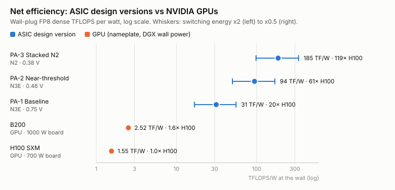
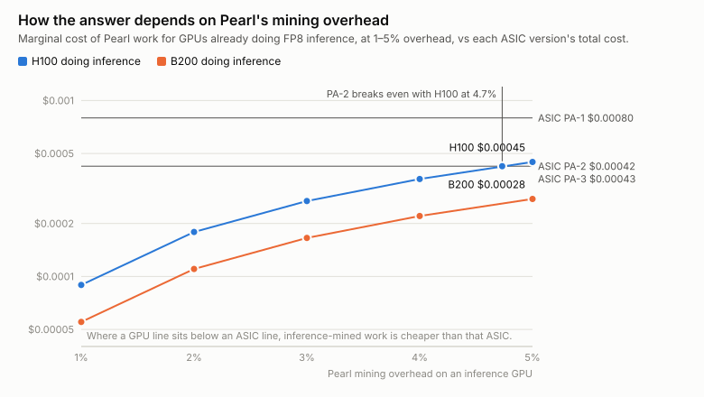

# ASIC design versions

*Generated by `cargo run --release -- figures` from `src/designs.rs`. Do not edit by hand.*

All versions share the verified DP32 datapath (H100 semantics, `src/atom.rs`), the weight-stationary core (`src/engine.rs`), 2048 output columns × k = 2048 per die, and on-chip A′ generation. Efficiency is net, i.e. wall-plug including power delivery and cooling. GPUs are at nameplate dense FP8 with DGX wall power.

## Summary

| version | codename | status | node · Vdd | PE | TFLOPS/W (wall) | × H100 | × B200 | USD/EFLOP |
|---|---|---|---|---|---|---|---|---|
| **PA-1** | Baseline | reference only — thermally impractical | TSMC N3E-class · 0.75 V | 1-col | 31 (17–55) | 20× | 12× | $0.00080 |
| **PA-2** | Near-threshold | RECOMMENDED — cost-optimal on N3 | TSMC N3E-class · 0.46 V | 2-col | 94 (50–169) | 61× | 37× | $0.00042 |
| **PA-3** | Stacked N2 | stretch — maximum efficiency | TSMC N2-class · 0.38 V | 4-col | 185 (98–333) | 119× | 74× | $0.00043 |
| H100 SXM | GPU | — | TSMC 4N | — | 1.55 | 1× | 0.62× | $0.1775 pure / $0.000089 inference |
| B200 | GPU | — | TSMC 4NP | — | 2.52 | 1.62× | 1× | $0.1167 pure / $0.000055 inference |

The range in parentheses is the switching-energy band (×2 pessimistic to ×0.5 optimistic).

## Sensitivity to Pearl's mining overhead

Ratio of each ASIC's total cost per EFLOP to the marginal cost for a GPU that is already doing FP8 inference, at different mining overheads. Below 1.0 the ASIC is cheaper. Break-even is the overhead at which the two are equal.

| version | vs | 1% | 2% | 3% | 4% | 5% | break-even overhead |
|---|---|---|---|---|---|---|---|
| PA-1 | H100 SXM inference | 8.90× | 4.45× | 2.97× | 2.23× | 1.78× | **8.9%** |
| PA-1 | B200 inference | 14.44× | 7.22× | 4.81× | 3.61× | 2.89× | **14.4%** |
| PA-2 | H100 SXM inference | 4.73× | 2.37× | 1.58× | 1.18× | 0.95× | **4.7%** |
| PA-2 | B200 inference | 7.67× | 3.84× | 2.56× | 1.92× | 1.53× | **7.7%** |
| PA-3 | H100 SXM inference | 4.78× | 2.39× | 1.59× | 1.19× | 0.96× | **4.8%** |
| PA-3 | B200 inference | 7.75× | 3.87× | 2.58× | 1.94× | 1.55× | **7.7%** |

## PA-1 — Baseline

**Status:** reference only — thermally impractical  
N3 at nominal 0.75 V, 1-column PEs. The straightforward port of the verified datapath.

**Changes:**

- DP32 atom with H100 semantics (13-bit window): 667 GE/MAC vs 958 for B200 semantics
- Weight-stationary B' in clock-gated latches; A' generated on chip (no DRAM)
- 2048 columns x k=2048 per die; 16x16 lottery tile per core

| spec | value |
|---|---|
| process | TSMC N3E-class |
| core voltage | 0.75 V |
| clock | 1.20 GHz |
| die area | 132 mm² |
| FP8 MACs / cycle | 4.19 M |
| throughput | 10.1 PFLOPS FP8 dense |
| chip power | 273 W |
| power density | 2.07 W/mm² |
| logic density | 667 GE/MAC |
| energy (chip / wall) | 54.2 / 63.8 fJ per MAC |
| efficiency (chip / wall) | 37 / 31 TFLOPS/W |
| vs H100 (wall-to-wall) | 20× (11–36×) |
| vs B200 (wall-to-wall) | 12× (7–22×) |
| die + package cost | $63 |
| USD per EFLOP | $0.00080 (energy 0.00044 + capex 0.00035) |
| vs H100 inference by-product | 8.9× its marginal cost |

## PA-2 — Near-threshold

**Status:** RECOMMENDED — cost-optimal on N3  
N3 at 0.46 V (cost-optimal point of the voltage sweep), 2-column PEs sharing the A' register.

**Changes:**

- Vdd 0.75 V -> 0.46 V: ~2.7x less switching energy; power density 2.1 -> 0.27 W/mm^2 (air-coolable)
- 2-column PEs halve A' operand-register and wire energy per MAC
- 0.46 V chosen by minimum USD/EFLOP (energy + capex), not maximum efficiency

| spec | value |
|---|---|
| process | TSMC N3E-class |
| core voltage | 0.46 V |
| clock | 0.46 GHz |
| die area | 132 mm² |
| FP8 MACs / cycle | 4.19 M |
| throughput | 3.9 PFLOPS FP8 dense |
| chip power | 36 W |
| power density | 0.27 W/mm² |
| logic density | 667 GE/MAC |
| energy (chip / wall) | 18.6 / 21.2 fJ per MAC |
| efficiency (chip / wall) | 107 / 94 TFLOPS/W |
| vs H100 (wall-to-wall) | 61× (32–109×) |
| vs B200 (wall-to-wall) | 37× (20–67×) |
| die + package cost | $63 |
| USD per EFLOP | $0.00042 (energy 0.00015 + capex 0.00028) |
| vs H100 inference by-product | 4.7× its marginal cost |

## PA-3 — Stacked N2

**Status:** stretch — maximum efficiency  
N2 at 0.38 V, 4-column PEs, boards voltage-stacked Bitcoin-miner style.

**Changes:**

- N3 -> N2 (GAA): ~20% lower switched capacitance, denser cells
- Vdd 0.38 V with series-stacked chips (~25 per string): power delivery 0.92 -> 0.94
- 4-column PEs: A' movement amortised over 4 outputs
- Trades ~25% higher cost per EFLOP than the N2 cost optimum for maximum TFLOPS/W

| spec | value |
|---|---|
| process | TSMC N2-class |
| core voltage | 0.38 V |
| clock | 0.32 GHz |
| die area | 112 mm² |
| FP8 MACs / cycle | 4.19 M |
| throughput | 2.7 PFLOPS FP8 dense |
| chip power | 13 W |
| power density | 0.12 W/mm² |
| logic density | 667 GE/MAC |
| energy (chip / wall) | 9.7 / 10.8 fJ per MAC |
| efficiency (chip / wall) | 205 / 185 TFLOPS/W |
| vs H100 (wall-to-wall) | 119× (63–215×) |
| vs B200 (wall-to-wall) | 74× (39–132×) |
| die + package cost | $73 |
| USD per EFLOP | $0.00043 (energy 0.00007 + capex 0.00035) |
| vs H100 inference by-product | 4.8× its marginal cost |

